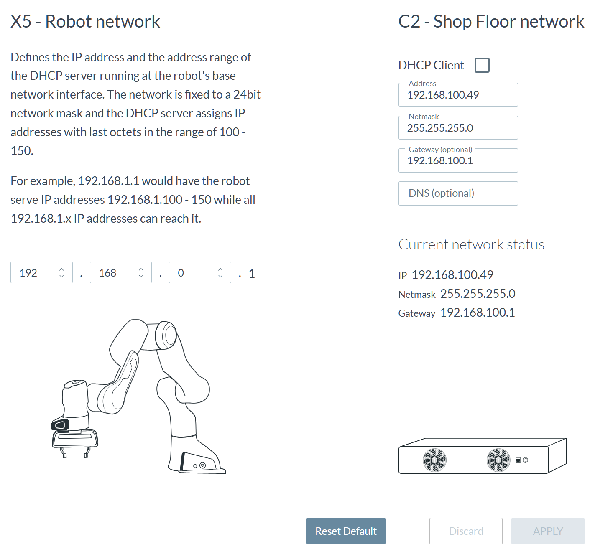
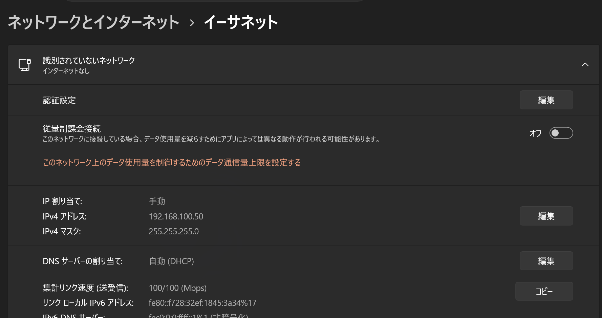

# Franka FR3 ピック＆プレース

## 本番では pick_and_place.py を使う

本番（デモ・展示）で動かすのは **`pick_and_place.py`** です。
ほかのスクリプトは動作確認や開発途中のもので、本番では使いません。

## 事前準備

- Desk の SETTINGS → Network が下の画像の設定になっていることを確認する
  - X5 - Robot network: `192.168.0.1`
  - C2 - Shop Floor network: DHCP Client オフ、Address `192.168.100.49`、Netmask `255.255.255.0`、Gateway `192.168.100.1`

  

- PC の Ethernet の設定が下の画像の設定になっていることを確認する（Windows の設定 → ネットワークとインターネット → イーサネット）
  - IP 割り当て: 手動、IPv4 アドレス `192.168.100.50`、IPv4 マスク `255.255.255.0`

  

## 新しい PC のセットアップ（初回のみ）

Windows の WSL2（Ubuntu）上で動かす。`pylibfranka` は Linux 用しかないため、Windows の Python では動かない。

### Windows 側（PowerShell を管理者で開いて実行）

1. WSL2 と Ubuntu を入れる
   ```powershell
   wsl --install -d Ubuntu
   ```
2. WSL のネットワークを mirrored にする（WSL から PC の Ethernet をそのまま使うため）
   ```powershell
   Set-Content -Path "$env:USERPROFILE\.wslconfig" -Value "[wsl2]`nnetworkingMode=mirrored"
   ```
3. ロボットから WSL への UDP を許可する
   ```powershell
   New-NetFirewallHyperVRule -Name franka-udp -DisplayName "Franka robot UDP" -Direction Inbound -VMCreatorId '{40E0AC32-46A5-438A-A0B2-2B479E8F2E90}' -Protocol UDP -RemoteAddresses 192.168.100.49 -Action Allow
   ```
   グリッパーの状態はロボットから UDP で届く。WSL のファイアウォールは初期設定で受信を止めるので、許可しないと「掴む」で `libfranka: TCP send bytes: I/O error` になる。
   それでも同じエラーになるときは、WSL への受信をすべて許可する（旧 PC はこの設定で動いていた）:
   ```powershell
   Set-NetFirewallHyperVVMSetting -Name '{40E0AC32-46A5-438A-A0B2-2B479E8F2E90}' -DefaultInboundAction Allow
   ```
4. WSL を再起動して設定を反映する
   ```powershell
   wsl --shutdown
   ```
5. 上の「事前準備」のとおり、Ethernet の IP を設定する
6. Ethernet アダプターの省電力をオフにする（デバイスマネージャー → ネットワーク アダプター → Ethernet のプロパティ）
   - 電源の管理: 「電力の節約のために、コンピューターでこのデバイスの電源をオフにできるようにする」をオフ
   - 詳細設定: 「Energy Efficient Ethernet」「Green Ethernet」などをオフ

### WSL（Ubuntu）側

```bash
sudo apt update && sudo apt install -y git curl
curl -LsSf https://astral.sh/uv/install.sh | sh
source ~/.bashrc

git clone https://github.com/atsukiwi/franka.git
cd franka
uv sync      # Python 3.12 と必要なライブラリを .venv に入れる
```

### 動作確認

ロボットの C2 ポートと PC を直結してから実行する。

```bash
ping 192.168.100.49                                  # 通信できるか
uv run python gripper_test.py                        # ハンドが開閉するか
uv run python pick_and_place.py --homing --count 1   # 1 往復だけ試す
```

## 起動方法

1. Control（四角い箱）の電源を入れる
2. Control の C2 ポートと PC を LAN ケーブルで直結する
3. ブラウザで https://192.168.100.49/desk/ を開けるか確認する
4. 起動する
   ```
   python pick_and_place.py --homing
   ```
   電源を入れた後は、必ず `--homing` を付けてグリッパーを初期化する（付けないと指の幅がずれて、開かなくなることがある）
5. 動かなければ、Desk の画面に出る「Grant」を押して制御を許可する

## 停止方法

```
python pack_pose.py
```

先に Franka Hand を外すこと。詳しくは下の「[片付け（パックポーズ）](#片付けパックポーズ)」を参照。

## オプション

```
uv sync                               # 初回のみ（ライブラリのインストール）
source .venv/bin/activate             # ターミナルを開くたびに実行
python pick_and_place.py              # Ctrl+C で止めるまで往復を繰り返す
python pick_and_place.py --count 3    # 3 往復で終了
python pick_and_place.py --homing     # 最初にグリッパーを初期化
python pick_and_place.py --force 50   # 把持力を 50 N で掴む（上限 70 N）
```

## 動作

1 往復の流れ:

1. 開く（最初の 1 回だけ）
2. `0_start-move` → 掴む → `0_end-move` → 離す（往路）
3. `0_end-move` → 掴む → `0_start-move` → 離す（復路）

- 掴めなかったときは、ハンドを開いて直前の移動タスクからやり直します（最大 `GRASP_RETRIES` 回）。
- それでも掴めないとき、またはエラーが出たときは止まり、制御権を返却します。
- 移動タスクの後の待ち時間などは、ファイル先頭の設定欄（`WAIT_...`）で調整します。

## 途中で止めるとき

Ctrl+C で止まります。ただし Desk のタスクが動いている途中なら、アームはそのタスクを最後まで続けることがあります。
すぐに止めたいときは、ロボット側の停止ボタンを使ってください。

## 片付け（パックポーズ）

終了時は `pack_pose.py` でアームを折り畳み姿勢（パックポーズ）にしてから電源を切ります。

**先に Franka Hand を外してください。** 付けたままだと本体にぶつかる恐れがあります。
実行すると確認が出るので、ハンドを外してロボットの周りに何もないことを確かめてから `y` を入力します。

```
python pack_pose.py              # パックポーズへ移動 → 関節をロック（通常はこれ）
python pack_pose.py --no-lock    # パックポーズへ移動するだけ（ロックしない）
python pack_pose.py --lock-only  # 移動せず、今の姿勢で関節をロックするだけ（確認なし）
```

ロックまで終わったら、Desk のメニューから Shut down します。

## そのほかのスクリプト（本番では使わない）

| ファイル | 内容 |
| --- | --- |
| `gripper_test.py` | Franka Hand を PC から開閉できるかの確認 |
| `move_and_grasp.py` | 移動タスク 1 回 → 掴む、までの確認用 |
| `desk_task_loop.py` | Desk のタスクを繰り返し実行するだけ（グリッパー操作なし） |
